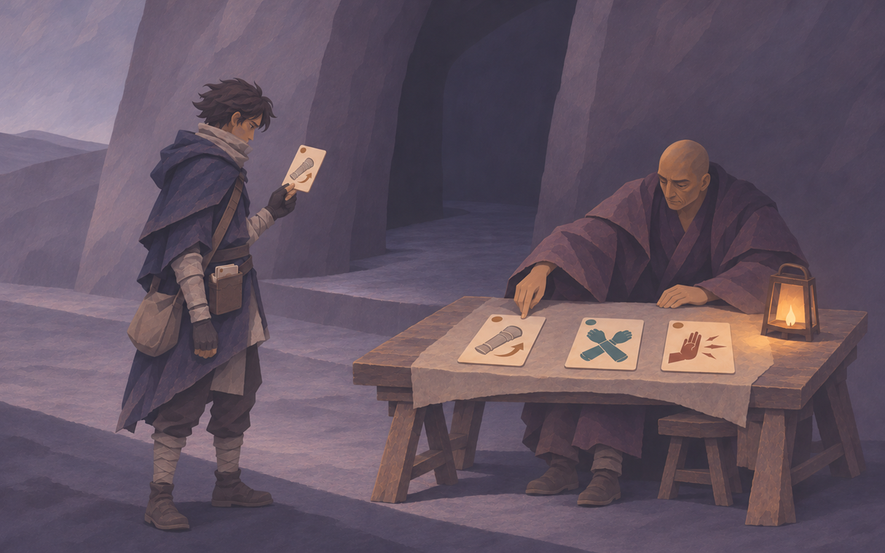
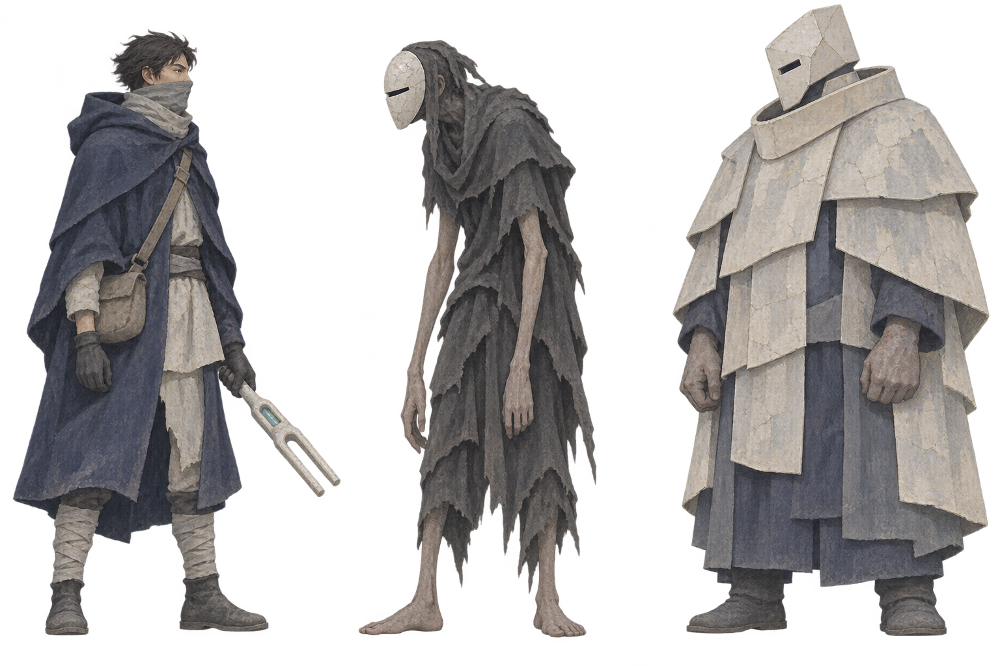
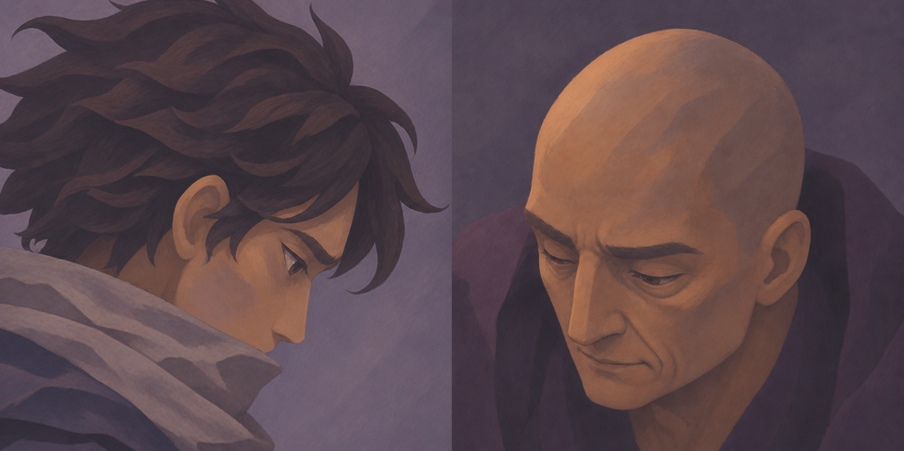
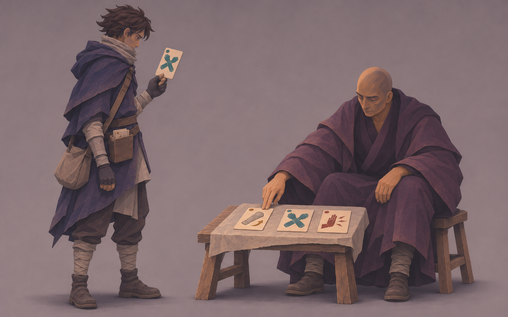
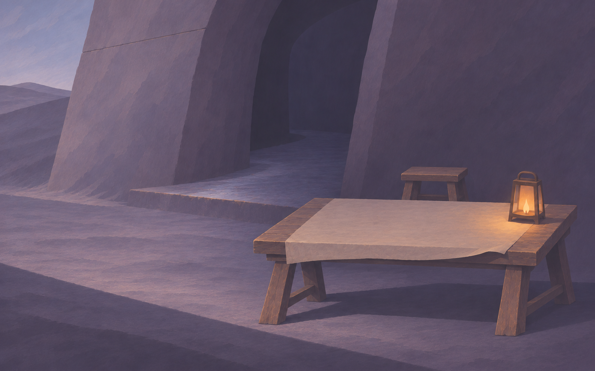

# 焦土迷宫美术设计需求

The end · 人物与迷宫入口美术需求 v0.7 · 2026年11月19日

首张关键帧画门前择牌。求生者腰间的口粮袋已经瘪了，装起始牌的硬匣仍扣在伸手可及的位置。他从匣中抽出自己的防御牌，和摊上那张回击牌并排看。守门人伸手把牌扶正，门内的路从两人身后拐进暗处。画面停在这趟探索即将添一张什么牌的决定上。

## 画风与色彩

**设定依据**　《世界观设定》给出了焦土中突然出现的迷宫、为寻找物资而来的玩家，以及对人麻木迟缓、对迷宫近乎狂热的守门人。原文让玩家有理由相信他经手的卡牌。迷宫的来历与深处景象仍是未知。

**本版画法**　“焦土迷宫”是工作名。人物比用户提供的三角色设定图稍低一档写实度。保留成人比例、衣料重量、叠穿的厚度和安静的神态。角色面部以双人定稿为准。青年求生者保留侧脸、下视的眉眼及灰围巾在口部的遮挡。守门人光头露面，低垂的眼睑、眉间折叠和鼻翼旁的深褶交代年纪。袖口和指关节保留干净的局部色与柔和明暗。背景采用第一版《门槛》的大色块。硬边墨线、油画笔触和照片级皮肤列为退回项。

### 画到什么程度

| 对象 | 首稿画法 | 可以收住的地方 |
| --- | --- | --- |
| 人物 | 接近参考图的成人身段。求生者以眉弓、鼻梁和围巾上缘交代朝向，守门人以低垂的眼睑和鼻侧交代朝向。布料的重量落在袖口和衣摆。 | 逐根头发收成发束，每层布留两三道主要褶皱。手部保持简洁。求生者眼角的浅色融入附近肤色，围巾以两三道布褶交代厚度。守门人的深褶以窄暗面衔接暖肤色。 |
| 地面与墙体 | 参照第一版，让灰坡、亮墙、背光墙和门洞各有一块明确明暗。 | 门内只露一次转折。大面积墙面保持平整，把最亮的一条边留给可走的门槛。 |
| 手与卡牌 | 求生者手里的旧牌与摊上候选共用费标和卡框。守门人从下缘扶牌，手指让开正面的招式图。 | 三张牌各画一个动作。把细节留给旧牌和候选之间能配合的防御、回击图形。 |

### 首轮色板

| 炭灰紫 | 尘蓝灰 | 灰土赭 | 旧纸米 | 余烬橙 |
| --- | --- | --- | --- | --- |
| #35323D | #727986 | #9A7C69 | #E1D3B4 | #CA9164 |
| 门洞与衣褶的积色 | 远墙与天光 | 焦土与粗布 | 牌面与纸底 | 灯芯及指尖反光 |

背景取色以首版为准。人物加用参考图的灰蓝布与骨白护片。两人共用冷灰天光，摊灯把暖色落在牌角和附近的手腕。腰间牌匣的磨痕、护臂的搭扣和收紧的绑腿交代他们所处的生存环境。

## 入口与迷宫内景

### 关键画面一　门槛

采用横向游戏中景，桌面略朝镜头转。求生者位于左中部，站立全身约占画高四至五成。两人相隔一步就能看牌。背后两片错位高墙超出画顶，地面的亮边越过门槛，在第一个转角消失。桌腿、凳脚与求生者脚底同框。

守门人低坐在右侧，把三张正面朝上的战斗牌摆在干净的布面上。其中一张略向前推，求生者正用手里的旧牌作比较。此刻只读选牌信息，两个人的动作都保持克制。看见门、牌和护具，就能预感进门后要面对的风险。

独立背景用横向 16∶10 游戏镜头。左侧留出求生者站立与走向门内的地面，右侧矮桌后留坐位。摊布铺平，桌面留出并排摆三张牌的空间。

*门前原图合成用于核对选定的两张脸与原有站位。手势、卡面和摊灯按指定原图保留。*

### 关键画面二　第一间回廊

入口退到画面边缘，只剩一截外面的光。用前后两片错开的墙和一道横向落影说明纵深。同一条磨亮的门槛边在远处再次出现，让人认得材质，却猜不出下个转角通往哪里。

| 场景层 | 画师应交代的内容 | 实机检查 |
| --- | --- | --- |
| 远景 | 天空、灰坡与冷灰高墙铺出大明暗，通道只露第一个转角。 | 缩小后先认出门洞，远景纹理不会盖过人物。 |
| 可活动地面 | 两名角色的落脚面连续，拾取点旁只留一处掀开的旧布或空匣。 | 脚底有明确接触，危险预告在敌人附近有安静底色。 |
| 近景 | 一侧可以压一小片塌墙暗形。下方约三成预留给满手牌。 | 在 1440 × 900 和 1024 × 768 两个窗口都能同时看见脚部、敌人意图和手牌费用。 |

## 求生者与守门人

*三人设定图供对照身段、布料与护片。双人面部定稿由两张指定特写直接拼合，左为青年求生者，右为守门人。围巾的位置、眼神以及脸上褶皱的深浅以各自半幅为准。*

### 求生者

暗发、灰蓝短披布、束紧的护臂和压瘪的口粮袋构成主轮廓。牌匣挂在惯用手一侧，边缘露出几张牌。求生者在摊前站稳，举起自己的牌，与桌上的候选比较。短披布的斜向下缘把目光引向他的手。青年求生者沿用选定左侧特写的乱发、下视的眼神和颊侧碎色。灰围巾斜贴口部，露出的脸颊与鼻尖按特写取形。

### 守门人

低坐、面容外露、宽袖落膝。旁人走近时眼皮只抬半拍，牌角一偏他便伸手推正。衣服和桌缘蒙灰，卡牌下面的一小块布始终干净。他半睁着眼理牌。下眼睑露出两层松弛的弧形，鼻翼旁的褶沟向嘴角渐淡。灰蓝天光照出褶的厚度，摊灯的暖光落在手和牌上。

| 时刻 | 看得见的表演 | 要读出的性格 |
| --- | --- | --- |
| 有人走近 | 他仍望着门缝，眼皮抬起半拍，肩膀随后才跟上。 | 对来客反应迟钝。 |
| 牌角被碰歪 | 目光先落到牌角，两指压平折边，把它缓缓推到布边的平行线上，停住才松手。 | 对迷宫之物的秩序近乎偏执。 |
| 交易成立 | 双手托住同一张牌，牌面朝向玩家递出，指尖始终让开图案。 | 玩家能看清买到的就是自己选中的东西。 |

角色原画把手、卡牌与前臂分层，便于后续调节扶牌停顿。首轮看站姿、披布与护具能否传出备战气质，同时让目光稳稳落在牌上。

## 卡面与交易界面

牌像守门人愿意双手托起的东西。纸边可以磨圆，正面有被细心压平的痕迹。牌背暂用两块错开的浅色门形作记号，与门槛构图呼应。正面的每张牌只画一个主要动作。

| 试画样牌 | 主图剪影 | 读图标准 |
| --- | --- | --- |
| 推掌 | 一只伸开的手把对方的影子推出亮区，指向画面外侧。 | 一眼读出发力方向与进攻。 |
| 架挡 | 收在胸前的前臂托起一块布垫，两者合成紧闭的斜面。 | 与伸手向外的攻击牌区分。 |
| 回击 | 沿护臂外缘折返的一道弧线，末端向外伸出。护臂轮廓呼应玩家手中旧防御牌。 | 能看出先挡再还手，理解这张牌为什么适合已有的防守牌。 |

### 守门人的交易摊

卡面费用属于出牌动作，交易价格另写在桌面价签上。主画面聚焦比较候选，牌仍在摊上。图中以「架挡」接「回击」示意本趟构筑的一种走向，具体费用、定价与伤害均为后续调值项。

<!-- figure:trade -->

*读区示意。“推掌”的牌面标 1 体力和 3 点伤害。桌面标价 2 物资，现有 3，成交后余 1。数字供排版使用。*

| 状态 | 玩家必须看到 | 反馈 |
| --- | --- | --- |
| 查看与比较 | 卡名、完整效果、交易价、自己的物资 | 牌平放在布上。点选后抬起一个牌角，展示“选中”字样，仍可换看另一张。 |
| 物资不足 | 例如余额 1、标价 2，显示“还差 1 物资” | 收起成交动作的亮色，保留读牌与离开。缺口标记和文字共同说明原因。 |
| 确认与成交 | 将支付的数量、余量、所选牌及去向 | 确认前可收手。确认后同一张牌从布面移向本趟牌组，价格与效果前后一致。 |

交易页第一眼读牌和价格，第二眼读守门人的手。战斗页第一眼读敌人意图和可用手牌。将这两张界面分别缩到小桌面尺寸，看视线是否仍落在正确的位置。

## 首轮交付与验收

先评入口和守门人，再扩展到门内战斗。只有这两张图一起成立，后续卡牌才有共同的用色、尺度和材质依据。

| 批次 | 素材 | 首轮交付 | 评审要点 |
| --- | --- | --- | --- |
| 首审 | 门前择牌 | 1 张求生者与守门人同框的入口概念图，另查缩略图 | 近看三种牌面与护具，远看两个人正在选牌。角色质感比用户参考略简化，门的去向清晰。 |
| 首审 | 求生者和守门人 | 各 1 张主轮廓，守门人另交 1 张半身和 3 格递牌动作 | 空袋能说明玩家的处境。遮住对白，仍能读出守门人对人和对牌的不同反应。 |
| 复审 | 门内回廊与敌影 | 1 张回廊分层底图，1 组静止和蓄势剪影，1 张带满手牌的合成图 | 头部、脚底和意图都留有读图区，门内空间的走向说得通。 |
| 复审 | 卡牌与交易 | 3 张样牌、1 张共用牌背，交易页交选中、物资不足、成交后三态 | 遮住牌名能区分三种动作。价格和体力各自带单位，成交的牌与所选一致。 |

### 交付格式

项目按 Pink/Cocos 原生场景的 1440 × 900 布局评审，小桌面另查 1024 × 768。场景源画建议 1920 × 1200，交可编辑分层文件与 PNG。角色用透明底，保留固定脚底注册点。守门人的手与桌面接触点另做标记。卡图建议 512 × 512，名称、效果和费用作为独立文字层。

### 签收方法

按 1440 × 900 查看两人的视线。用双人面部定稿核对左侧的围巾、眉眼和右侧的鼻唇沟、下眼睑，再在指定原图合成稿上核对头部大小及位置。再把入口缩到约 360 像素宽，指出人物、入口和牌摊的位置。把样牌缩成约 96 像素宽并遮住名称，按图形辨认动作。最后在完整交易样张上请一名未读设定的人指出所选牌、应付物资与成交后余量。记录误读的位置，再改对应的形状、对比或间距。

本稿据《世界观设定.docx》及本轮画风反馈编制，供主美、原画、角色动作和 UI 首轮对图。本轮已确定两位角色各自的面部参考。门前合成沿用指定原图的头部位置，全身人物与独立背景作为本轮概念稿。原生对照路径为 `assets/TheEnd.scene`、`assets/prefabs/screens/`、`assets/prefabs/cards/` 与 `tools/game-studios/pink-cocos.project.json`。

## 本轮人物与背景概念图

### 人物概念图

*青年求生者沿用选定的侧脸与灰围巾，拿起青绿色的架挡牌。守门人低坐理牌，宽袖让开扶正回击牌的手。*

### 迷宫入口背景概念图

*灰坡接到门槛的亮边，路在两片高墙间拐进暗处。右侧摊灯把暖光留在布面上，人物的落脚处、坐位和三张可选牌的位置留空。*
