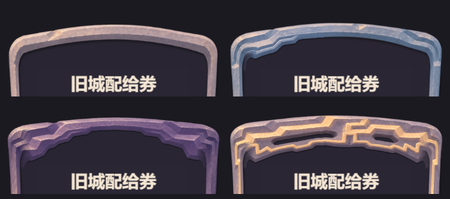

# 卡牌稀有度

适用项目为《The end》，范围为焦土迷宫的战斗卡和物资卡。更新于 2026-11-28。稀有度已在 `cyb/202611` 接入正式游戏和卡牌工坊，首轮投放平衡待玩家试玩。

## 已确认的规则

稀有度表示一张卡在对应奖励来源里有多难遇到。当普通战斗卡更适合当前牌组，或普通物资的兑换价值和重量更适合剩余的行囊空间时，玩家有理由选择更常见的卡。

战斗卡和物资卡共用普通、稀有、史诗、传说四档。普通要读作日常可用的卡，稀有的色调偏冷蓝，史诗用低饱和暗紫，传说用明亮的暖金。两类卡都只通过整副边框的造型和配色表达稀有度。

探索中能随机获得的卡标稀有度。仅随初始牌组固定发放的牌标「基础」，仅由效果生成的临时牌标「临时」。一张牌如果也能从随机发现中获得，就适用随机卡的档位规则。

## 卡面怎样表现稀有度

2026-11-28 玩家确认，四档完全依靠卡框自身的造型与配色辨认，战斗卡与物资卡共用，画风沿用焦土迷宫。普通卡用近乎平直的暖石顶边和轻微切角。从稀有开始，两肩抬起，形成第一道完整的冷蓝石拱。史诗沿用稀有卡的单拱。按玩家指定的手牌辨识度标准，本轮选用宽阴刻，暗紫拱面上凿出一段折返的迷宫纹，槽底压暗，槽口保留灰紫色的受光边。玩家同意采用更亮、更尖的传说金框。

正式卡面从同一图集取画，覆盖战斗手牌、发现和搜刮奖励，以及牌堆、行囊和仓库的大卡。工坊的「物资卡」和战斗卡奖励设置可编辑稀有度、同档权重，预览使用同一图集。随机牌及物资卡未填档位时按普通处理。仅固定发放的基础牌与临时牌使用现有牌面。首轮把封装电池设为稀有、旧城配给券设为传说，旧麻绳按普通投放。战斗候选中的盾矛为史诗，屠龙宝刀和龙血为传说。四档均可在工坊配置。

在 Pink/Cocos 隔离战斗预览中，将同一张「滑步」放在同一手牌位置，固定暗紫石材、迷宫线宽、雕刻深度和左上方光照，只切换凹凸方向。在 1440×900 和 1024×768 两种窗口里，阴刻槽底的连续暗部都更容易看清转折。浮雕顶面的亮部接近拱面原有的高光。对照图上方是框面细节，下方是 1024×768 窗口的手牌原尺寸截取。卡名、体力、插画与游戏状态已逐项核对。这次试排用于选定雕法，四档并排辨识仍待后续评审。[原尺寸雕法对照](card-rarity-frames/single-arch-carving/hand-comparison.png) · [战斗手牌全景](card-rarity-frames/single-arch-carving/battle-hand-1024.png) · [史诗卡透明样框](card-rarity-frames/single-arch-carving/epic-incised.png)

获准采用的传说方案保留单拱，将拱顶收为浅尖，两肩随拱梁各向外挑出一个短尖。拱顶朝光的切面用浅金黄，长边和底框也有金色受光面，凹槽保留暖褐与灰紫暗部。拱肩的迷宫纹沿两条侧边走到底边，在下框的阶形折返处接成完整图案。[同一张「滑步」的史诗与传说](card-rarity-frames/gold-gate/combat.png) · [同一张「旧城配给券」的两档卡框](card-rarity-frames/gold-gate/supplies.png)

在 1440×900 和 1024×768 的隔离战斗预览中，固定同一张「滑步」的位置切换两副框，比对名称、体力、插画和效果区域的截图像素，两种窗口均一致。把两副框分别套在相邻的两张「滑步」时，小窗口手牌中仍能看到金框尖顶和外肩。物资预制体另核对了「旧城配给券」的居中名称、价值 6 物资点和砝码上的 1。试排前后导出的游戏状态一致。透明样框为 568×952 像素，可叠在 224×340 设计单位的卡面外。[小窗口战斗手牌](card-rarity-frames/gold-gate/battle-hand-1024.png) · [传说透明样框](card-rarity-frames/gold-gate/legendary-frame.png) · [轮廓参照](card-rarity-frames/gold-gate/construction.png) · [原画](card-rarity-frames/gold-gate/painted-source.png) · [绘制提示](card-rarity-frames/gold-gate/imagegen-prompt.txt)

早期样稿先后尝试了卡名上方的独立小场景和与拱框连成一体的石阶。玩家认为前者突兀，后者的四档仍难以分辨。下表和配图记录已评审的内拱样稿。

| 档位 | 卡框内沿怎样变化 |
| --- | --- |
| 普通 | 暖灰石拱一笔贯通，两肩平顺，卡名上方留空。 |
| 稀有 | 冷蓝左框的倒角折入拱腹，形成一小段阶梯状的承托石，右肩保留素面。 |
| 史诗 | 暗紫拱肩从左右两侧分别伸出石阶，左长右短。中段留一段平顺的拱，阶梯的深度靠明暗两块石面交代。 |
| 传说 | 两肩的石阶接成横跨卡顶的内拱，刻出一长一短两个透空槽。暖金嵌线沿框侧折入、绕过石槽并在另一侧收回，深色牌底透过开口。 |

石料的灰紫背光、暖杏受光面和哑光笔触取自游戏已经使用的上行石阶牌背、下行拱廊牌背和石廊原画。四档共用向两肩过渡的浅拱、略微内收的长边与收脚。金线沿雕刻的受光面走，静止时也能看清。[与现有抽牌背同场对照](card-rarity-frames/stone-arch/game-art-comparison.png) · [金框掠光动效](card-rarity-frames/stone-arch/legendary-sheen.webp)

在隔离的 Pink/Cocos Web 游戏构建中，以同一张「旧城配给券」和同一张「逆相探针」比较四档，核对名称、插画、价值与砝码、体力和效果。又在检修暗槽的搜刮界面与实际战斗手牌中试排，检查了 1440×900、1024×768 两种窗口。手牌中的两张「滑步」临时套用史诗和传说框，用于比较相同插画的轮廓。试排只改变本次画面，前后导出的游戏状态一致。[四档物资卡](card-rarity-frames/stone-arch/supplies.png) · [四档战斗卡](card-rarity-frames/stone-arch/combat.png) · [搜刮界面](card-rarity-frames/stone-arch/loot-scene.png) · [战斗手牌](card-rarity-frames/stone-arch/battle-hand.png) · [小窗口手牌](card-rarity-frames/stone-arch/battle-hand-small.png)

该轮试排图集按左上、右上、左下、右下排列，每格 568×952 像素，对应 284×476 设计单位。美术参照在 `art-source/ashen-labyrinth/combat-ui/`，场景原画在 `assets/ashen-survivor/light-cut-passage.png`。[透明卡框图集](card-rarity-frames/stone-arch/frames.png) · [拱肩绘制原图](card-rarity-frames/stone-arch/painted-lintels.png) · [ImageGen 内置工具绘制提示](card-rarity-frames/stone-arch/imagegen-prompts.txt)

## 金色卡的试玩目标

战斗发现与物资搜刮分别调节出现频率。以十趟完整探索为尺度，初版目标是约三趟在战斗发现时至少见到一张金色候选，约一趟在搜刮时至少见到一张金色物资。两种来源分别统计。候选一旦展示即计入本趟，同类金卡在该趟出现多次也只计一趟。玩家后来如何选牌、是否拿取或成功带回物资，都不影响本次展示的记录。

从第一处能随机发现战斗卡或搜到物资的地点起，就有小概率见到相应的金卡。初配在第 0 至 16 层之间线性插值。战斗候选每处的传说概率从 1.4% 升至 5.3%，搜刮物资从 1.6% 升至 7.0%。按 12,000 张生成地图、每个路口等概率选后续房间并走完全程估算，至少遇到一张传说战斗卡的比例约为 30.5%，至少遇到一张传说物资的比例约为 10.1%。

## 奖励如何抽取

奖励地点先按所属来源和地图深度抽稀有度，再按该档内各张卡的权重抽具体卡。往一个已有金卡的池中添加金卡，会增加该档可遇到的品种。在工坊调卡牌权重可以改变同档内各张卡的相对机会，地点的档位概率单独配置。

一次战斗发现三选一只判定一次出金，最多展示一张传说卡。命中时，传说卡随机占一个候选位置，其余候选从有可用卡的普通、稀有、史诗三档抽取，同一候选只出现一次。该战解锁的拳流派终结技仍占固定名额，若配置为传说，同组已用掉传说名额。之后遇到的发现点会各自判定出金，因此同一趟探索可多次见到传说卡。

每趟探索独立抽取。即使此前连续十趟没见金色物资，下一趟也按玩家走到的地点和深度计算出金机会。首轮试玩接受这种运气差异。

## 现有实现

焦土迷宫在 `assets/game/core/systems/RewardRules.ts` 按层数和来源抽档，再按 `assets/resources/data/cards.json` 的 `rewardWeight` 抽卡。`CardCatalog.ts` 校验四档和可用卡牌身份。`SaveRepository.ts` 兼容旧签名，新增存档允许修改稀有度和焦土迷宫投放权重，重载后已展示的候选 ID 保持原序。原生显示由 `CardPresentation.ts` 叠放纸底和框体。游戏和 Web 工坊的素材坐标见 [原生资源规格](production-asset-spec.md)。

Pink/Cocos Web 正式构建已走通随机搜刮、入袋、返营入库与兑换。实际选到的金框战斗卡也在后续战斗抽到，重载后可继续。旧存档试样可领取保存时已经展示的物资。测试覆盖 1440×900 和 1024×768 两种窗口。[传说候选](card-rarity-frames/in-game/battle-discovery-1440.png) · [普通、稀有、史诗](card-rarity-frames/in-game/three-grades-1024.png) · [战斗手牌](card-rarity-frames/in-game/hand-1024.png) · [已入库的传说物资](card-rarity-frames/in-game/warehouse-1024.png) · [工坊改档预览](card-rarity-frames/in-game/editor-epic.png)
